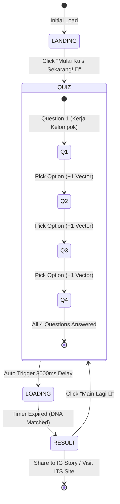

# 🎻 THE VIOLINIST (VIOLINIST.md)
**The Concertmaster, Strings Section & Lead User Experience Engineer**
*Version: 2.2.0 — Frontend Flow & Client Interaction Architecture*
*Classification: User Interface Engineering Specification*

---

## 📑 TABLE OF CONTENTS
1. [Persona Definition & The Concertmaster Mandate](#1-persona-definition--the-concertmaster-mandate)
2. [Component Architecture: Next.js 16 App Router Composition](#2-component-architecture-nextjs-16-app-router-composition)
3. [The Complete Screen Transition State Machine](#3-the-complete-screen-transition-state-machine)
4. [Mobile-First Touch Ergonomics & Viewport Engineering](#4-mobile-first-touch-ergonomics--viewport-engineering)
5. [Landing View Implementation Protocol (`LandingView.tsx`)](#5-landing-view-implementation-protocol-landingviewtsx)
6. [Interactive Question Protocol (`QuestionView.tsx`)](#6-interactive-question-protocol-questionviewtsx)
7. [Radar Scanner Implementation Protocol (`LoadingView.tsx`)](#7-radar-scanner-implementation-protocol-loadingviewtsx)
8. [Result Celebration Protocol (`ResultView.tsx`)](#8-result-celebration-protocol-resultviewtsx)
9. [Performance Budgets (LCP < 1.0s, CLS 0, INP < 50ms)](#9-performance-budgets-lcp--10s-cls-0-inp--50ms)
10. [Handoff Gate to Flutist & Percussionist](#10-handoff-gate-to-flutist--percussionist)

---

## 1. PERSONA DEFINITION & THE CONCERTMASTER MANDATE

### 1.1 The Lead Melody of Code
In our symphonic architecture, **THE VIOLINIST** holds the first violin chair. The strings carry the primary theme that the audience experiences continuously. While the backend provides resonance and the conductor ensures order, **The Violinist crafts the immediate tactile interface that user fingers touch on glass**.

```
                   ┌────────────────────────────────────────┐
                   │          THE VIOLINIST'S CORE          │
                   ├────────────────────────────────────────┤
                   │  Component Composition (Next.js 16)    │
                   │  State-Driven Fluid Transitions        │
                   │  Touch Target Ergonomics (48px Min)    │
                   │  Mobile-First Performance & Zero CLS   │
                   └────────────────────────────────────────┘
```

* **Core Mandate:** Transform the visual compositions of `ARTIST` into responsive, accessible, zero-lag React 19 client components with semantic HTML.
* **Paired Skill Ecosystem:** `design-taste-frontend`, `responsive-craft`, `react-best-practices`.
* **Primary Output:** Next.js client components mounted in `src/components/`, state hooks, and interaction handlers.

---

## 2. COMPONENT ARCHITECTURE: NEXT.JS 16 APP ROUTER COMPOSITION

The frontend adopts a streamlined Atomic Flow architecture:

```
src/
├── app/
│   ├── layout.tsx             # Root layout (Fonts, viewport meta, global theme)
│   ├── globals.css            # Tailwind CSS v4 directives & theme tokens
│   └── page.tsx               # Orchestrator Entry (Mounts QuizApp client boundary)
├── components/
│   ├── QuizApp.tsx            # Master state container (The Conductor's podium)
│   ├── LandingView.tsx        # Movement I: Hero & CTA
│   ├── QuestionView.tsx       # Movement II: 4-step interactive card
│   ├── LoadingView.tsx        # Movement III: 3-second radar DNA scan
│   ├── ResultView.tsx         # Movement IV: Matched prodi, badges & CTAs
│   └── StoryCard.tsx          # 9:16 Hidden render target for html-to-image export
└── data/
    └── quiz-data.ts           # Immutable questions, prodi profiles, and weight matrix
```

---

## 3. THE COMPLETE SCREEN TRANSITION STATE MACHINE

The user journey transitions seamlessly through four distinct phases without page reloads:



### 3.1 State Interface Contract
```typescript
export type QuizStage = 'landing' | 'quiz' | 'loading' | 'result';

export interface QuizAppState {
  stage: QuizStage;
  currentQuestionIndex: number;
  scores: Record<string, number>;
  matchedProdiId: string | null;
  tieBreakerSeed: number;
  isGeneratingStory: boolean;
}
```

---

## 4. MOBILE-FIRST TOUCH ERGONOMICS & VIEWPORT ENGINEERING

Visitors at an expo booth will interact while standing, holding phones in one hand, often jostled by crowds. The Violinist enforces strict ergonomics:

1. **The 48px Golden Touch Rule:** Every interactive button, answer card, or toggle must have a minimum tap target height of `48px` (preferably `56px` to `64px` for answer options).
2. **Thumb-Zone Optimization:** Critical CTA buttons (`Mulai Kuis`, `Share IG Story`) must sit in the lower 40% of the viewport.
3. **Viewport Lockout:** Prevention of disruptive mobile zoom gestures on double-tap:
   ```html
   <meta name="viewport" content="width=device-width, initial-scale=1, maximum-scale=1, user-scalable=no" />
   ```

---

## 5. LANDING VIEW IMPLEMENTATION PROTOCOL (`LandingView.tsx`)

### 5.1 Anatomical Structure
* **Header Capsule:** Small glowing pill displaying `"✦ SHAPETOOL EXPO ITS 2026"`.
* **Hero Headline:** ExtraBold gradient text: `"Cocoklogi: DNA Prodi Baru ITS Kamu Banget!"`.
* **Sub-hero Narrative:** `"Cari tahu prodi mana yang paling pas sama kepribadian dan mimpimu cuma dalam 1 menit!"`.
* **Floating Feature Badges:** 3 pills highlighting:
  * ⚡ *4 Pertanyaan Kilat*
  * 🧬 *100% Relate Anak Muda*
  * 📖 *Terkoneksi Majalah ShapeTool*
* **Big Action CTA:** Massive Gold button with rocket emoji and active spring compression.

---

## 6. INTERACTIVE QUESTION PROTOCOL (`QuestionView.tsx`)

### 6.1 Question Progression & Animation
* Each question is presented as a high-contrast card.
* **Segmented Laser Progress Bar:** Visual indicators show `Step 1/4`, `Step 2/4`, `Step 3/4`, `Step 4/4`.
* **Answer Row Specs:**
  * Option letter pill: `w-9 h-9 rounded-xl bg-slate-800 text-amber-400 font-bold`.
  * Text area: `text-sm sm:text-base font-medium text-slate-100`.
  * Hover / Active state: `hover:border-amber-400/60 active:scale-[0.98] transition-all`.
  * Auto-advance: As soon as an option is tapped, a 200ms tactile feedback delay executes before transitioning to the next question.

---

## 7. RADAR SCANNER IMPLEMENTATION PROTOCOL (`LoadingView.tsx`)

### 7.1 Visual Pacing & Suspense Choreography
* The 3-second delay prevents the quiz from feeling trivial or algorithmic.
* **Centerpiece:** Animated SVG radar scanner with spinning sweep line and glowing concentric target circles.
* **Rotating Status Stream:**
  * `0ms - 1000ms:` "🧬 Mengambil sampel DNA jawabanmu..."
  * `1000ms - 2000ms:` "📡 Menganalisis frekuensi dengan 5 database Prodi Baru..."
  * `2000ms - 3000ms:` "✨ 100% Cocok! Mengunci hasil rekomendasi..."

---

## 8. RESULT CELEBRATION PROTOCOL (`ResultView.tsx`)

### 8.1 Layout Anatomy of Victory
* **Celebration Banner:** `"✨ MATCHED! Kamu Fix Banget Anak [Nama Prodi]! ✨"`.
* **Persona Hero Badge:** e.g., `"THE DIGITAL HUSTLER"`, with distinct accent glows.
* **Match Score:** High-status radial pill: `96% Match DNA`.
* **Persona Traits Chips:** 3 pill tags indicating behavioral strengths.
* **Magazine ShapeTool Anchor:** Physical callout box:
  * *"📖 Buka Majalah ShapeTool Halaman [X] buat ngintip lab dan fasilitas asyiknya!"*
* **Action CTAs Trio:**
  * Primary: `[ 📸 Download / Share ke IG Story ]` (Generates canvas export).
  * Secondary: `[ 🔄 Main Lagi ]` (Resets state back to Question 1).
  * Tertiary: `[ 🌐 Cek Info Resmi Prodi ]` (Opens official ITS portal in new tab).

---

## 9. PERFORMANCE BUDGETS (LCP < 1.0s, CLS 0, INP < 50ms)

Expo booth environments suffer from erratic cellular connectivity. The Violinist enforces:

| Performance Metric | Target Threshold | Implementation Strategy |
| :--- | :---: | :--- |
| **First Contentful Paint (FCP)** | < 600ms | Inline critical Tailwind CSS, zero external render-blocking scripts. |
| **Largest Contentful Paint (LCP)** | < 1.0s | SVG icons used exclusively; zero uncompressed raster assets. |
| **Cumulative Layout Shift (CLS)** | 0.000 | Explicit aspect ratios and heights on all animated cards and buttons. |
| **Interaction to Next Paint (INP)**| < 50ms | State updates batched via React 19 transitions, lightweight event handlers. |

---

## 10. HANDOFF GATE TO FLUTIST & PERCUSSIONIST

Before releasing components to `FLUTIST` for motion polish and `PERCUSSIONIST` for build gating, The Violinist runs the following pre-flight checklist:

```
[VIOLINIST PRE-FLIGHT CHECKLIST]
[x] All interactive elements have accessible aria-labels.
[x] Zero TypeScript errors with strict checking enabled.
[x] Viewport displays cleanly on 320px, 375px, 390px, and 428px widths.
[x] Button tap areas exceed 48px vertical height.
[x] No horizontal scroll overflow occurs during screen transitions.
```

---

*End of Violinist Specification. Play the melody with precision and soul.*
